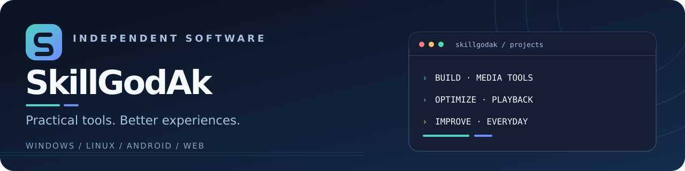
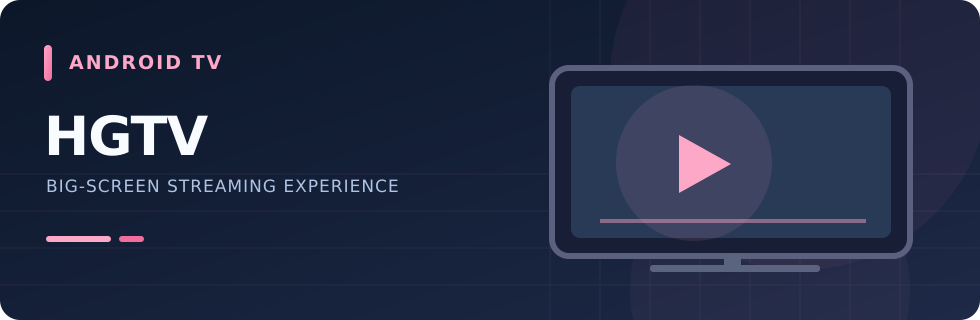
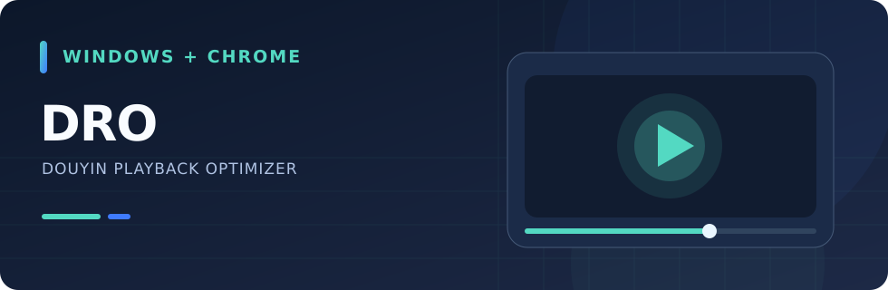
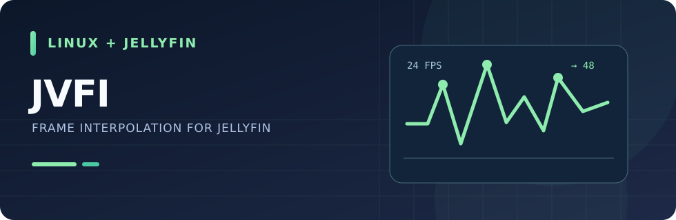
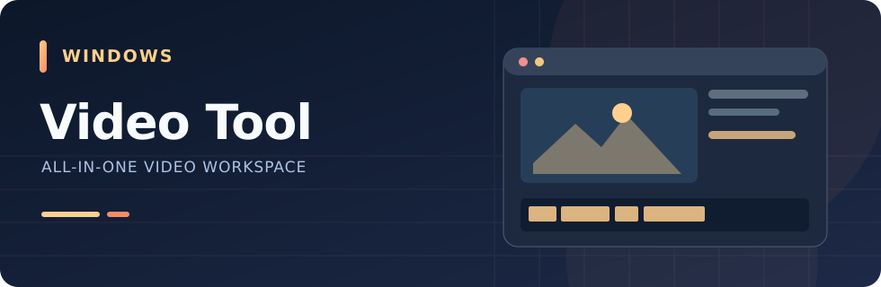
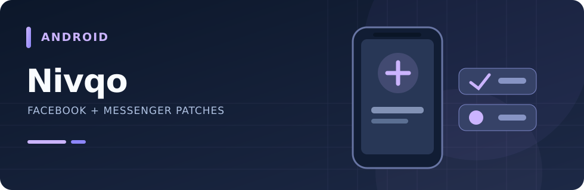
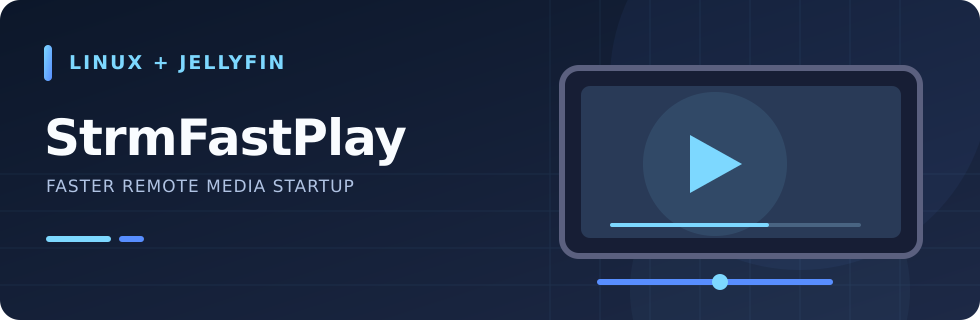

  <picture>
    <source media="(prefers-color-scheme: dark)" srcset="./assets/banner-dark.svg">
    <source media="(prefers-color-scheme: light)" srcset="./assets/banner-light.svg">
    
  </picture>

  <b>讓常用軟體更順手，讓影音體驗更流暢。</b> 
  Windows、Linux、Android 與網頁工具｜獨立開發與專案整合

  <a href="#featured">精選作品</a>　·　<a href="#projects">更多專案</a>　·　<a href="#support">支持開發</a>

---

## ✦ 精選作品 / Featured Projects

從 Android TV 追劇、播放優化，到 Windows 影音工具與 Jellyfin 插件。點擊圖片或按鈕即可查看詳細介紹。

<table width="100%">
  <tr>
    <td width="50%" valign="top">
      
      
<b><a href="https://github.com/SkillGodAk/HGTV">HGTV</a></b> · ANDROID TV

      
專為 Android TV 與電視盒設計，支援遙控器操作、播放紀錄與介面主題。

      
 

    </td>
    <td width="50%" valign="top">
      
      
<b><a href="https://github.com/SkillGodAk/DRO">DRO</a></b> · WINDOWS + CHROME

      
抖音桌面版與 Chrome 網頁版兩種獨立工具，針對不同播放環境提供優化方案。

      
 

    </td>
  </tr>
</table>

<table width="100%">
  <tr>
    <td width="50%" valign="top">
      
      
<b><a href="https://github.com/SkillGodAk/JVFI">JVFI</a></b> · LINUX + JELLYFIN

      
Jellyfin 伺服器端即時補幀，支援自訂幀率與符合條件的平滑效果。

      
 

    </td>
    <td width="50%" valign="top">
      
      
<b><a href="https://github.com/SkillGodAk/multi-function-video-tool">多功能影片處理工具</a></b> · WINDOWS

      
整合影片轉檔、字幕處理、音軌管理和批次整理的 Windows 工具。

      
 

    </td>
  </tr>
</table>

<table width="100%">
  <tr>
    <td width="50%" valign="top">
      
      
<b><a href="https://github.com/SkillGodAk/Nivqo">Nivqo</a></b> · ANDROID

      
整合 Facebook / Messenger 修補功能與繁體中文介面的 Android 專案。

      
 

    </td>
    <td width="50%" valign="top">
      
      
<b><a href="https://github.com/SkillGodAk/StrmFastPlay">StrmFastPlay</a></b> · LINUX + JELLYFIN

      
為 Jellyfin 的 STRM／網盤遠端播放縮短起播等待，支援直鏈、302 播放與預先準備下一集。

      
 

    </td>
  </tr>
</table>

## ◈ 探索更多 / Explore More

<b>🎬 影音與播放</b> — 3 個專案

- [JVFI](https://github.com/SkillGodAk/JVFI) — Jellyfin 即時補幀插件
- [DRO](https://github.com/SkillGodAk/DRO) — 抖音桌面／網頁播放優化
- [StrmFastPlay](https://github.com/SkillGodAk/StrmFastPlay) — Jellyfin STRM／網盤遠端播放加速插件

<b>🖥️ Windows 與字幕工具</b> — 1 個專案

- [多功能影片處理工具](https://github.com/SkillGodAk/multi-function-video-tool) — 影片、音軌與字幕整合處理

<b>📱 Android 與電視</b> — 2 個專案

- [Nivqo](https://github.com/SkillGodAk/Nivqo) — Facebook／Messenger 中文化與功能整合
- [HGTV](https://github.com/SkillGodAk/HGTV) — Android TV 追劇 App

<b>🧰 其他工具與系統專案</b> — 4 個專案

- [Tools](https://github.com/SkillGodAk/tools)
- [MagiskOnWSA](https://github.com/SkillGodAk/MagiskOnWSA)
- [X96Q-ProPlus-H728-EmuELEC](https://github.com/SkillGodAk/X96Q-ProPlus-H728-EmuELEC)
- [SkillGodAk.github.io](https://github.com/SkillGodAk/SkillGodAk.github.io)

<a href="https://github.com/SkillGodAk?tab=repositories"><b>→ 查看全部公開儲存庫</b></a>

---

